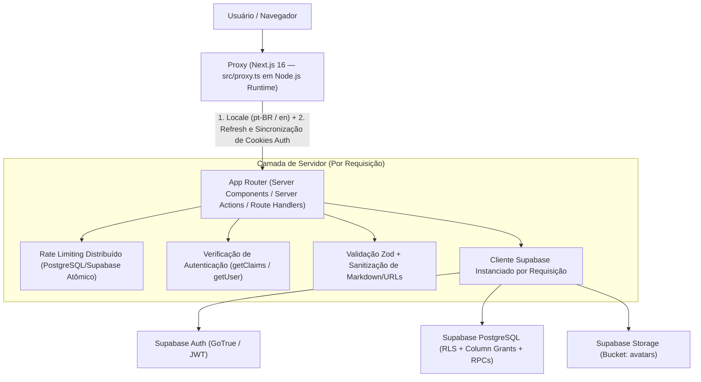

# Arquitetura e Estrutura Inicial do Projeto

Este documento descreve a arquitetura e a organização planejada do repositório `cybersec-community-platform` para revisão antes do início da implementação do frontend.

---

## 1. Visão Geral da Arquitetura e Separação de Responsabilidades



### 1.1. Separação de Responsabilidades (Defesa em Camadas)

A segurança e o roteamento **não dependem exclusivamente da camada Proxy**. Cada preocupação arquitetural possui uma camada própria e bem delimitada:

1. **Atualização de Sessão (`src/lib/supabase/session.ts`):**
   - Executada na camada **Proxy do Next.js 16** (`src/proxy.ts`, rodando em runtime Node.js) para renovar tokens de acesso expirados e sincronizar cookies HTTP entre a requisição e a resposta.
   - Como **Server Components podem apenas ler cookies, mas não gravá-los durante a renderização**, a renovação e a persistência de cookies atualizados de sessão devem ser tratadas obrigatoriamente pelo `src/proxy.ts` (e, quando aplicável, em Server Actions e Route Handlers).
2. **Internacionalização (`src/lib/i18n/`):**
   - Idiomas iniciais permitidos: **`pt-BR` e `en`** (`SUPPORTED_LOCALES = ['pt-BR', 'en'] as const`).
   - Qualquer locale ausente ou inválido na URL, cookie ou cabeçalho `Accept-Language` realiza **fallback automático** para o idioma padrão configurado (`DEFAULT_LOCALE = 'pt-BR'`, ajustável via `NEXT_PUBLIC_DEFAULT_LOCALE`).
   - Sincroniza com `profiles.preferred_locale` para usuários autenticados e consome as colunas bilíngues `name_pt`/`name_en` e `description_pt`/`description_en` de `public.categories`.
3. **Autorização (Servidor + Banco de Dados):**
   - O `src/proxy.ts` realiza apenas redirecionamentos de conveniência de navegação (UX), **nunca** sendo tratado como barreira definitiva de segurança.
   - Estratégia de autenticação e verificação no servidor:
     - Utilizar **`supabase.auth.getClaims()`** para verificar criptograficamente os JWTs e proteger páginas e acesso a dados com baixa latência.
     - Utilizar **`supabase.auth.getUser()`** quando for necessário consultar o registro atualizado do usuário diretamente no serviço Supabase Auth (ex.: operações sensíveis de conta/sessão).
     - **Não utilizar `supabase.auth.getSession()` isoladamente** para decisões de autorização no servidor.
   - A barreira final de segurança e autorização permanece no banco de dados por meio de **GRANTs por coluna**, **policies de Row Level Security (RLS)** e **RPCs `SECURITY DEFINER`** (que revalidam `is_active_member()`, `is_moderator()` e `is_admin()`).
4. **Rate Limiting (`src/lib/security/rate-limit.ts` + PostgreSQL/Supabase):**
   - **Decisão para o MVP:** Utilizar o próprio **PostgreSQL/Supabase** como armazenamento compartilhado distribuído, sem adicionar dependências ou serviços externos (como Upstash ou Redis) neste primeiro momento.
   - **Requisitos técnicos obrigatórios:**
     - **Operações atômicas:** Contagem e verificação de janela de tempo executadas atomicamente no banco (ex.: `INSERT ... ON CONFLICT DO UPDATE` via função `SECURITY DEFINER` com `search_path = ''`).
     - **Acesso restrito à tabela de controle:** A tabela de rate limit terá RLS ativo e **nenhum GRANT direto** de leitura/escrita para `anon` ou `authenticated`, sendo manipulada exclusivamente pela função controlada.
     - **Privacidade (sem IP em texto puro):** Nunca armazenar endereços IP em texto puro; utilizar identificadores autenticados (`auth.uid()`) ou hash criptográfico irreversível (ex.: SHA-256 com salt) quando for necessário limitar por origem de rede.
     - **Limpeza de registros expirados:** Prever expurgo automático/periódico de janelas de tempo expiradas para manter a tabela enxuta.
     - **Sem dependência de memória local:** Não utilizar memória em processo (`Map` local) como mecanismo principal, garantindo consistência em execução serverless/distribuída.

### 1.2. Clientes Supabase por Contexto de Requisição

Para evitar vazamento de sessão ou compartilhamento indevido de estado entre usuários concorrentes no servidor, **é proibido instanciar clientes Supabase em escopo global no servidor**:

- **Cliente de Navegador (`src/lib/supabase/client.ts`):** Usa `createBrowserClient<Database>()` do `@supabase/ssr` exclusivamente para Client Components.
- **Cliente de Servidor por Requisição (`src/lib/supabase/server.ts`):** Expõe uma função fábrica assíncrona (`createRequestSupabaseClient()`) que instancia `createServerClient<Database>()` **dentro do escopo de cada requisição** (Server Component, Server Action ou Route Handler), vinculada ao `cookies()` do `next/headers` daquela requisição específica. Como Server Components não podem gravar cookies durante a renderização, o handler `setAll` no cliente de Server Component ignora falhas de escrita com segurança, delegando a renovação e sincronização dos cookies ao `src/proxy.ts`.
- **Zero `service_role` no fluxo de usuários:** Operações de membros, moderadores e administradores utilizam sempre o cliente autenticado com o JWT do próprio usuário para que o PostgreSQL aplique RLS e registre `auth.uid()` em `audit_logs`.

### 1.3. Convenção `src/proxy.ts` no Next.js 16 (Node.js Runtime)

- **Decisão confirmada:** O projeto utilizará **Next.js 16**, adotando a convenção oficial `src/proxy.ts` executando em **runtime Node.js**.
- Toda a lógica de atualização/sincronização de cookies de sessão e negociação de locale ficará isolada em funções modulares dentro de `src/lib/supabase/session.ts` e `src/lib/i18n/`, sendo invocada pelo `src/proxy.ts`.

### 1.4. Segurança de Conteúdo, Markdown e Validação de URLs Externas

Como a plataforma é voltada ao público de cibersegurança, todo conteúdo enviado por usuários (`resources.description`, `topics.body`, `posts.body`, `profiles.bio`) é tratado como **não confiável**:

1. **Renderização e Sanitização de Markdown:**
   - HTML bruto embutido no Markdown é **desabilitado por padrão**.
   - A renderização deve passar por sanitização estrita baseada em allowlist (ex.: `rehype-sanitize`), permitindo apenas formatação textual segura (parágrafos, títulos, listas, blocos de código com syntax highlighting, links `http/https` e ênfase).
   - Tags e vetores executáveis (`<script>`, `<iframe>`, `<object>`, `<embed>`, `<svg>`, `<form>`, `<style>` e atributos `on*` / `style`) são integralmente removidos.
2. **Validação e Renderização de URLs Externas:**
   - **Na entrada (Zod + SQL):** Validação estrita de protocolo, aceitando apenas `http://` ou `https://` em `resources.url` (e exclusivamente `https://` em `avatar_url`, `github_url` e `linkedin_url`), rejeitando `javascript:`, `data:`, `vbscript:`, `file:` e caracteres de controle/espaços.
   - **Na exibição (`<a>`):** Todo link externo renderizado no catálogo, fórum ou perfis deve conter obrigatoriamente `target="_blank"` e `rel="noopener noreferrer ugc"`, além de passar por um helper de verificação de protocolo seguro antes de preencher o atributo `href`.
3. **Marca Desacoplada:**
   - Nome provisório, textos institucionais e tokens visuais ficam centralizados em `src/config/site.ts` e nas variáveis CSS do tema Dark Mode, sem fixar marca, domínio ou logotipo definitivo até aprovação.

---

## 2. Estrutura de Diretórios Planejada

A organização separa claramente **roteamento (`src/app/`)**, **regras de negócio e domínio por funcionalidade (`src/features/`)**, **infraestrutura compartilhada (`src/lib/`)** e **primitivas visuais (`src/components/ui/`)**:

```text
cybersec-community-platform/
├── docs/
│   ├── PROJECT_CONTEXT.md                # Contexto e escopo oficial do MVP
│   ├── ARCHITECTURE.md                   # Este documento de arquitetura
│   └── database/
│       ├── README.md                     # Guia de execução no Supabase e Postgres local
│       ├── ERD.md                        # Diagrama ER e decisões de modelagem
│       └── SECURITY.md                   # Matriz de permissões, ameaças e operação
├── supabase/
│   ├── config.toml                       # Configuração declarativa do projeto Supabase CLI
│   ├── migrations/
│   │   ├── 20261110000001_schema.sql
│   │   ├── 20261110000002_functions_triggers.sql
│   │   └── 20261110000003_rls_and_grants.sql
│   ├── seed.sql                          # 12 categorias iniciais (pt-BR / en)
│   └── tests/
│       ├── postgres_bootstrap.sql        # Simulação local para testes em Postgres puro
│       └── rls_smoke_test.sql            # 48 verificações de RLS e integridade
├── src/                                  # (A ser criado somente após aprovação)
│   ├── proxy.ts                          # Next.js 16 Proxy (Node.js runtime: locale + refresh de cookies)
│   ├── app/
│   │   └── [locale]/                     # Rotas internacionalizadas (pt-BR | en + fallback)
│   │       ├── layout.tsx
│   │       ├── page.tsx
│   │       ├── catalog/                  # 4.1 Catálogo e 4.4 Submissão de recursos
│   │       ├── forum/                    # 4.2 Fórum comunitário
│   │       ├── u/[username]/             # 4.3 Perfil público do membro
│   │       ├── settings/                 # Edição de perfil, avatar, favoritos, contribuições
│   │       ├── moderation/               # 4.5 Fila de moderação (recursos e denúncias)
│   │       ├── admin/                    # 4.5 Categorias, usuários/papéis e audit_logs
│   │       └── auth/                     # Login, cadastro, recuperação e callback
│   ├── features/                         # Regras de negócio, queries, actions e schemas por domínio
│   │   ├── auth/
│   │   ├── catalog/                      # Busca, filtros, submissão, bookmarks
│   │   ├── forum/                        # Tópicos, posts, tags, votos, solução aceita
│   │   ├── profile/                      # Perfil, upload de avatar, contribuições
│   │   ├── moderation/                   # Aprovação/rejeição de recursos, denúncias
│   │   └── admin/                        # Gestão de categorias, papéis, suspensão e auditoria
│   ├── components/
│   │   ├── ui/                           # Primitivas visuais reutilizáveis (shadcn/ui)
│   │   └── layout/                       # Header, Footer, LanguageSwitcher, navegação
│   ├── lib/
│   │   ├── supabase/
│   │   │   ├── client.ts                 # Cliente para Client Components (browser)
│   │   │   ├── server.ts                 # Fábrica de cliente por requisição (servidor)
│   │   │   └── session.ts                # Helper de atualização de sessão para middleware/proxy
│   │   ├── security/
│   │   │   ├── sanitize.ts               # Sanitização de Markdown e validação de URLs seguras
│   │   │   └── rate-limit.ts             # Limitação de requisições para mutações
│   │   └── i18n/                         # Configuração de locales (pt-BR, en), fallback e dicionários
│   ├── types/
│   │   ├── database.generated.ts         # Gerado automaticamente via `supabase gen types typescript`
│   │   └── index.ts                      # Aliases e tipos derivados consumidos pela aplicação
│   └── config/
│       └── site.ts                       # Configuração provisória de identidade/marca
├── .env.example
├── .gitignore
└── README.md
```

### 2.1. Geração de Tipos TypeScript do Banco

- O arquivo `src/types/database.generated.ts` **não deve ser editado manualmente**. Ele será gerado diretamente a partir do schema Supabase (`supabase gen types typescript --local > src/types/database.generated.ts` ou `--project-id`).
- Tipos utilitários derivados (ex.: `ProfileRow`, `ResourceWithCategory`, `TopicDetail`) ficam em `src/types/index.ts` ou dentro de cada módulo em `src/features/`, garantindo que novas execuções do gerador não sobrescrevam código manual.

---

## 3. Diferenças entre o PostgreSQL Local e o Ambiente Supabase Real

O teste executado no PostgreSQL 18 local com [`postgres_bootstrap.sql`](../supabase/tests/postgres_bootstrap.sql) **não é 100% idêntico ao ambiente Supabase completo**. A tabela abaixo explicita o que já foi validado localmente e o que depende de validação integrada no Supabase (CLI ou Cloud):

| Aspecto | Validado no PostgreSQL Local (Atual) | Depende de Validação no Supabase Real (CLI / Cloud) |
|---|---|---|
| **DDL, Constraints, Índices, `tsvector` e `pg_trgm`** | ✅ Validado diretamente no PostgreSQL 18 | Mesmo motor PostgreSQL; validar execução via `supabase db reset` / `db push` |
| **Triggers, RPCs `SECURITY DEFINER` e `audit_logs`** | ✅ Validado nos 48 testes de `rls_smoke_test.sql` | Validar chamadas via cliente PostgREST (`supabase.rpc(...)`) |
| **GRANTs por coluna e lógica das Policies RLS** | ✅ Validado com simulação de `request.jwt.claims` | Validar com tokens JWT reais emitidos pelo GoTrue e expostos via PostgREST |
| **Autenticação (`auth.users`)** | ⚠️ Apenas tabela e `auth.uid()` simulados | **Fluxos reais do Supabase Auth:** cadastro, confirmação de e-mail, login, recuperação de senha, rotação de refresh token, captcha e disparo real do trigger `on_auth_user_created` |
| **Armazenamento (`storage.buckets` / `objects`)** | ⚠️ Apenas políticas RLS simuladas em tabelas locais | **Serviço real do Supabase Storage:** upload multipart, imposição física do limite de 2 MB e dos MIME types (`image/png`, `image/jpeg`, `image/webp`) e URLs públicas de CDN |

---

## 4. Etapas Planejadas de Implementação

1. **Etapa A — Configuração Base (Next.js 16 + Supabase CLI + Tipagem Gerada):**
   - Criar `supabase/config.toml` e configurar scripts de geração de tipos (`database.generated.ts`).
   - Inicializar **Next.js 16** (TypeScript, Tailwind CSS, shadcn/ui) com tema Dark Mode padrão e identidade provisória isolada em `src/config/site.ts`.
   - Implementar as fábricas de cliente Supabase por requisição (`client.ts`, `server.ts`, `session.ts`) e o ponto de entrada `src/proxy.ts` (runtime Node.js).
2. **Etapa B — Internacionalização (`pt-BR` / `en`), Layout Principal e Autenticação (`features/auth` & `features/profile`):**
   - Roteamento `[locale]` com idiomas `pt-BR` e `en` e fallback para o idioma padrão.
   - Layout responsivo, cabeçalho, troca de idioma e fluxos de autenticação com Supabase Auth real.
   - Páginas de perfil público (`/u/[username]`) e configurações (`/settings`), incluindo upload seguro de avatar no Supabase Storage.
3. **Etapa C — Catálogo de Recursos e Contribuição Comunitária (`features/catalog`):**
   - Listagem com busca textual (`search_vector` + `pg_trgm`), filtros por categoria, tipo e dificuldade, página individual do recurso, favoritos (`bookmarks`) e submissão de novos recursos (`status = 'pending'`).
4. **Etapa D — Fórum Comunitário (`features/forum`):**
   - Listagem e busca de tópicos (`topics.search_vector`), criação de tópicos com até 5 tags, respostas com Markdown sanitizado, votos (`votes`), marcação de solução (`set_accepted_post`) e denúncias (`reports`).
5. **Etapa E — Painel de Moderação e Administração (`features/moderation` & `features/admin`):**
   - Fila de aprovação/rejeição de recursos (`moderate_resource`), fila de denúncias (`resolve_report`), moderação de tópicos/respostas, gestão de categorias (auditada), papéis/suspensão de usuários e consulta a `audit_logs`.
6. **Etapa F — Testes, Segurança, Acessibilidade, Responsividade e Preparação para Lançamento:**
   - **Testes integrados no Supabase real:** Validação fim a fim de Auth (GoTrue), Storage (upload real no bucket `avatars` respeitando MIME/2 MB) e RLS via API PostgREST, além da execução de `rls_smoke_test.sql` no CI.
   - **Auditoria de Segurança da Aplicação:** Verificação de sanitização de Markdown contra payloads XSS, validação de URLs externas (`rel="noopener noreferrer ugc"`), cabeçalhos HTTP de segurança (CSP, `X-Frame-Options`, `Referrer-Policy`, `X-Content-Type-Options`) e testes de rate limiting nas Server Actions/Route Handlers.
   - **Acessibilidade (WCAG AA):** Navegação completa por teclado, foco visível no tema Dark Mode, contraste adequado de cores (grafite/ciano/texto), atributos ARIA nos componentes interativos (modais de denúncia, filtros, abas e alertas de formulário).
   - **Responsividade:** Revisão em viewports mobile, tablet e desktop para o catálogo, leitura de tópicos do fórum e painéis de moderação/admin.
   - **Checklist de Publicação:** Revisão de variáveis de ambiente na Vercel, políticas de backup/migração no Supabase e documentação para contribuidores open source.
