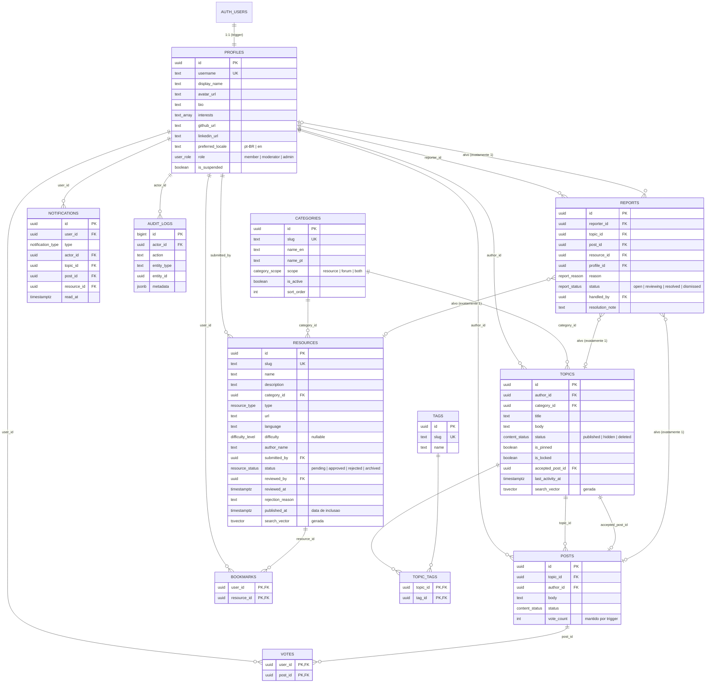

# Diagrama de relacionamentos (ERD)

Renderiza automaticamente no GitHub (Mermaid). Colunas de auditoria (`created_at`, `updated_at`) omitidas por legibilidade.

## Decisões de modelagem

| Decisão | Motivo |
|---|---|
| `categories` compartilhada entre catálogo e fórum, com `scope` e nomes `name_en`/`name_pt` | Uma única fonte de categorias; i18n das categorias já resolvida no banco. |
| `reports` com 4 FKs nulas + `CHECK (num_nonnulls(...) = 1)` | Integridade referencial real (um alvo polimórfico genérico não teria FK). |
| FK composta `topics(accepted_post_id, id) → posts(id, topic_id)` | O banco garante que a resposta aceita pertence ao próprio tópico. |
| `author_id` / `submitted_by` com `ON DELETE SET NULL` | Excluir a conta não apaga discussões de outras pessoas (compatível com LGPD/GDPR: o perfil some, o conteúdo anonimiza). |
| `categories` com `ON DELETE RESTRICT` | Categoria em uso é desativada (`is_active = false`), nunca apagada. Alterações administrativas disparam trigger para `audit_logs`. |
| Busca no catálogo e no fórum: `tsvector` (config `simple`) + `pg_trgm` | Funciona para PT e EN sem dicionário por idioma; em `topics`, o título tem peso `A` e o corpo peso `B`, além de `pg_trgm` no nome do recurso e no título do tópico. |
| Deduplicação de URLs: `normalize_resource_url(url)` | Normaliza esquema e host em minúsculas, remove portas padrão (`:80`/`:443`) e barra apenas na raiz vazia, preservando case-sensitivity de caminho/query e caminhos distintos (`/dir/` vs `/dir`). |
| Descrição de recursos até 2.000 caracteres | Permite detalhar ferramentas, laboratórios e repositórios na página individual do recurso. |
| Votos só em respostas (`posts`) | Conforme o escopo do MVP ("curtir ou votar em respostas"). |
| `audit_logs` com `bigint identity` | Tabela só de inserção, ordenação cronológica barata. |

## Fora do schema atual (extensões previstas)

- Tags em recursos (`resource_tags`): o contexto só prevê `topic_tags`. Fácil de adicionar depois.
- Favoritar tópicos.
- Busca com `unaccent` (não é `IMMUTABLE`, exigiria coluna materializada ou função wrapper).
